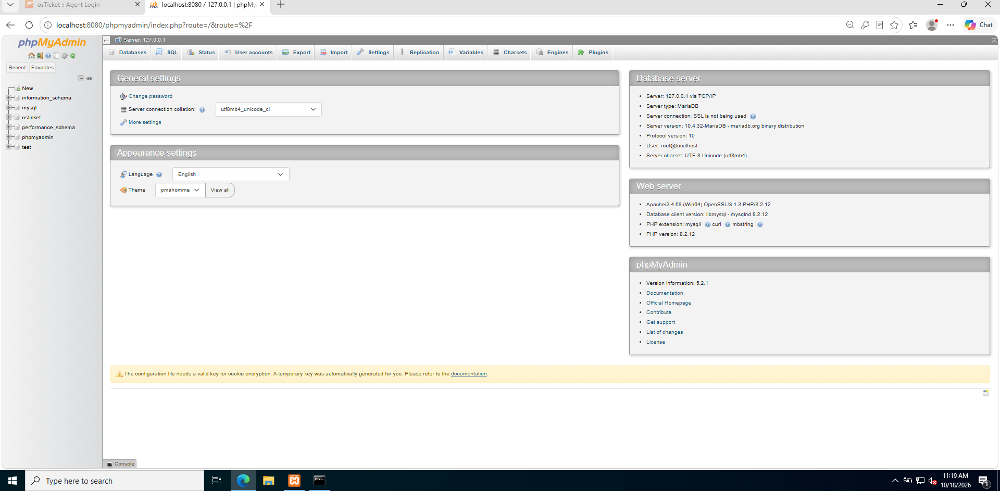
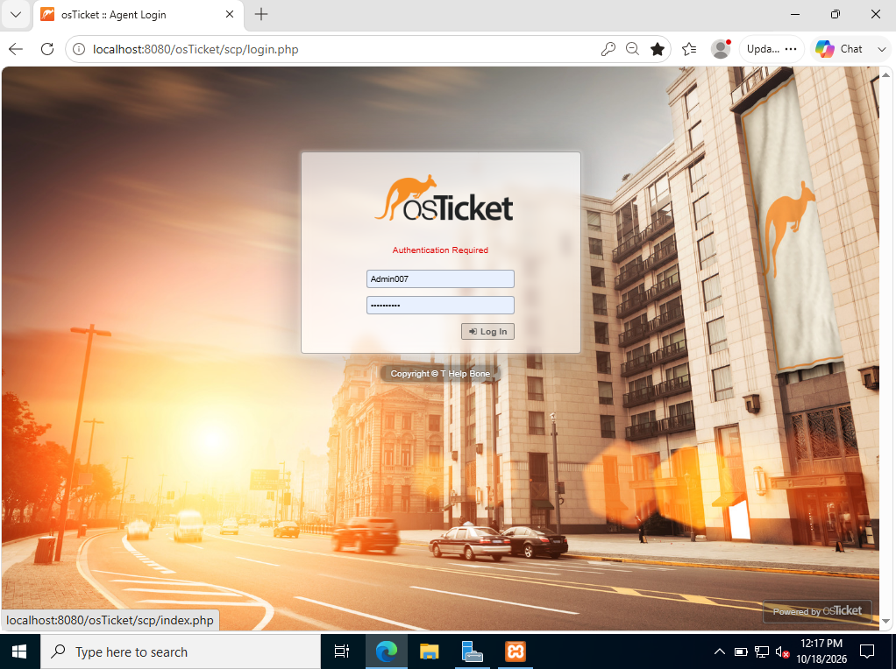
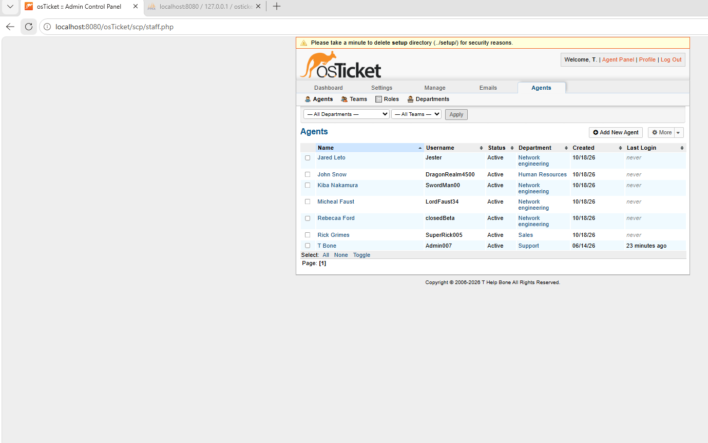
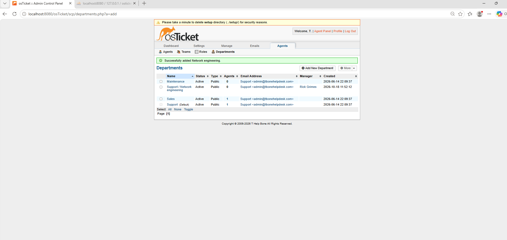
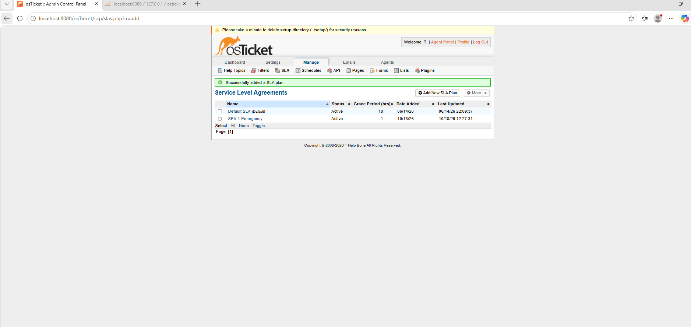
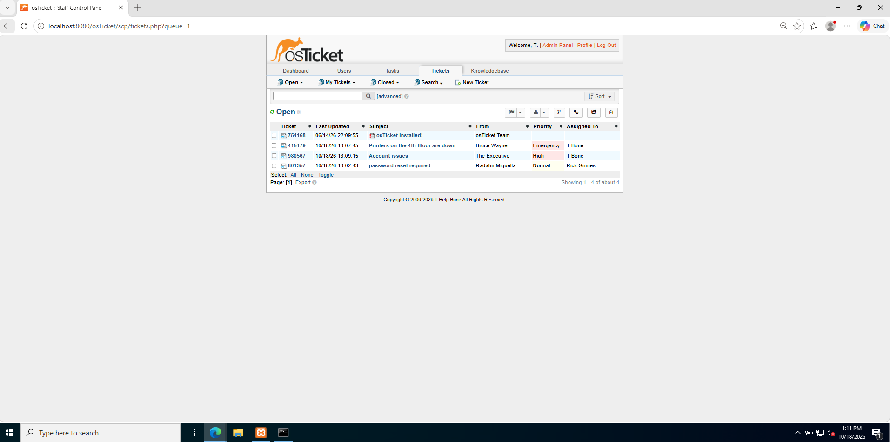
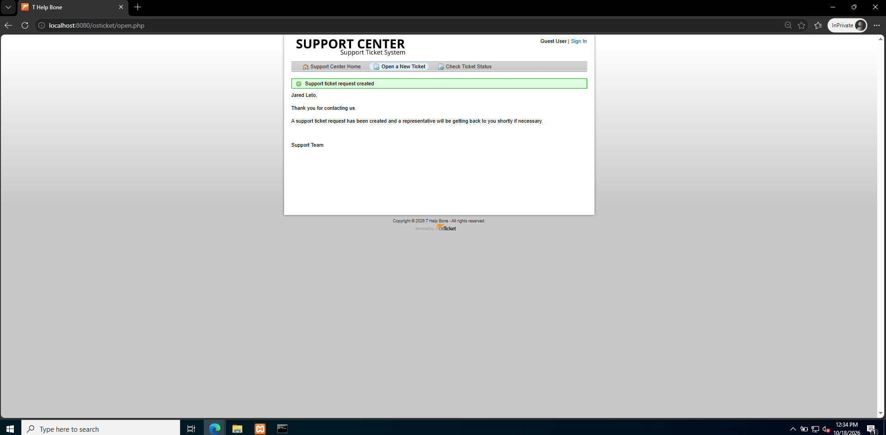
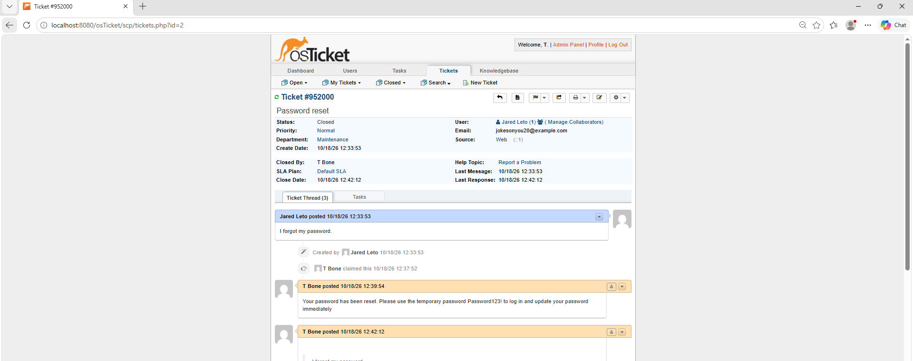

# osTicket - Ticketing System Implementation & Lifecycle Lab

## 📌 Project Overview
This project documents the end-to-end deployment, configuration, and operational lifecycle management of an enterprise helpdesk ticketing system using **osTicket** hosted on a local web server stack. The lab demonstrates core IT Service Management (ITSM) principles including Role-Based Access Control (RBAC), Service Level Agreement (SLA) enforcement, ticket routing, incident triage, and ticket resolution workflows.

---

## 🛠️ Tech Stack & Environment
* **Web Server Stack:** XAMPP (Apache, MySQL, PHP)
* **Database Management:** phpMyAdmin & MySQL
* **Ticketing System:** osTicket v1.17+
* **Virtualization:** Oracle VirtualBox (Windows Server 2022 / Windows 11)

---

## 🚀 Key Implementation & Troubleshooting Steps

### 1. Web Server & Database Authentication Configuration
* Deployed osTicket within XAMPP and resolved port conflicts between Apache and IIS.
* Configured local database connection settings inside `config.inc.php` (`auth_type = 'cookie'`) to resolve authentication parameters and gain administrative access via phpMyAdmin.

---

### 2. User Provisioning & Role-Based Access Control (RBAC)
* Created support agent profiles (e.g., `SuperRick005`) and configured granular role permissions to enforce least-privilege security standards.
* Established organizational departments (e.g., *System Administration*, *Support*) for structured ticket allocation and routing.

---

### 3. Service Level Agreements (SLAs) & Help Topics
* Configured custom SLA response policies (e.g., **SEV-1 Emergency** with a 1-hour grace period) to prioritize urgent outages over routine service requests.
* Mapped user help topics to automatically trigger SLA rules and departmental routing upon ticket creation.

---

### 4. Incident Triage & Impact Prioritization
Simulated a real-world multi-ticket incoming queue to demonstrate IT Service Management (ITSM) incident triage based on **Business Impact vs. Urgency**:

* **Emergency Priority (`Printers on 4th floor are down`):** Assigned top priority due to multi-user business impact stopping workflow across an entire floor. Mapped to the `SEV-1 Emergency` 1-hour SLA.
* **High Priority (`Executive Account Issues`):** Prioritized for immediate follow-up and communication due to high organizational visibility, queued directly after critical site/hardware outage resolution.
* **Normal Priority (`Standard Password Reset`):** Processed through standard helpdesk SLA workflow without disrupting high-impact incidents.

---

### 5. End-to-End Ticket Lifecycle Simulation
* **Creation:** Simulated end-user ticket submission via the customer portal (`http://localhost:8080/osticket/`).
* **Assignment & Communication:** Logged into the Agent Control Panel (`/scp`), claimed ownership of tickets, and communicated reset instructions directly to the end-user.
* **Resolution:** Verified ticket updates within the audit log and updated status to **Closed**.

---

## 💡 Key Skills Demonstrated
* **IT Service Management (ITSM):** SLA enforcement, incident triage, ticket routing, and escalation management.
* **System Administration:** Apache/MySQL database configuration, web server management, and user privilege assignment.
* **Troubleshooting:** Resolving port conflicts, authentication errors, and database access settings.
